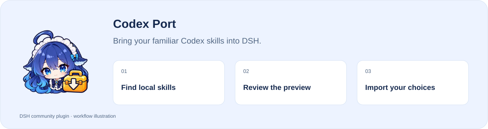

[简体中文](README.md) · **English**

# Codex Port

> **Preview and port your favorite Codex skills safely into DeepSeek Harness.**

Codex skill porting plugin for DeepSeek Harness (`>=0.2.2-rc.3`): discovers local skills, previews target paths and name collisions before copying, preserves invocation policies and licenses, and handles Windows paths cleanly.

[](https://www.npmjs.com/package/dsh-codex-port) [](https://www.npmjs.com/package/dsh-codex-port) [](https://www.npmjs.com/package/dsh-codex-port)

**[Features](#features) · [Install](#install) · [Workflow](#start-using-it) · [Full guide](https://github.com/STARDUSTLC666/dsh-codex-port/blob/master/docs/REFERENCE.en.md)**

<picture>
  <source media="(prefers-color-scheme: dark) and (max-width: 640px)" srcset="https://raw.githubusercontent.com/STARDUSTLC666/dsh-codex-port/master/docs/assets/intro/workflow-en-mobile-dark.svg">
  <source media="(max-width: 640px)" srcset="https://raw.githubusercontent.com/STARDUSTLC666/dsh-codex-port/master/docs/assets/intro/workflow-en-mobile-light.svg">
  <source media="(prefers-color-scheme: dark)" srcset="https://raw.githubusercontent.com/STARDUSTLC666/dsh-codex-port/master/docs/assets/intro/workflow-en-dark.svg">
  
</picture>

## Features

| Capability | Details |
| :--- | :--- |
| **Local Discovery** | Scans local Codex skills and reports dependencies and licenses before copying anything |
| **Conflict-Safe Preview** | Previews destination paths and name collisions ahead of import while leaving originals untouched |
| **Policy & License Preservation** | Retains invocation rules and license files with Windows path support and Cordis hot-reload cleanup |

## Install

Open **Plugins** in the DSH desktop app and install `dsh-codex-port`, or use the CLI:

```bash
dsh plugin --profile desktop add dsh-codex-port
```

For the web profile, replace `desktop` with `web` and restart DSH. Requires DSH `>=0.2.2-rc.3`.

## Start using it

1. **Point at local skills**: Open a session in the target DSH workspace and identify your Codex skills folder.
2. **Inspect before copying**: Ask for a list of portable skills, dependencies, and licenses first.
3. **Preview & import selectively**: Review target paths and name conflicts, then import only the skills you want.
4. **Verify in DSH**: Invoke an imported skill to confirm it works; original skills stay untouched.

### Example prompt

> List locally available skills and preview the destination and conflicts. Do not import yet.

## Before you start

- Imported skills may still require their own local runtimes or third-party tools.
- Full configuration, tools, and troubleshooting: [full reference](https://github.com/STARDUSTLC666/dsh-codex-port/blob/master/docs/REFERENCE.en.md).

## Plugin updates

Check updates at the bottom of native plugin details. Automatic checks are on by default; **automatic installation is off**. Suite-managed components update with their bundle.

## Documentation & feedback

- [Full usage, configuration and limits](https://github.com/STARDUSTLC666/dsh-codex-port/blob/master/docs/REFERENCE.en.md) · [Release notes](https://github.com/STARDUSTLC666/dsh-codex-port/blob/master/CHANGELOG.md) · [Validation history](https://github.com/STARDUSTLC666/dsh-codex-port/blob/master/docs/VALIDATION.md)
- Stars, [Issues](https://github.com/STARDUSTLC666/dsh-codex-port/issues), and [PRs](https://github.com/STARDUSTLC666/dsh-codex-port/pulls) are welcome (strip credentials first).

## License

[MIT](https://github.com/STARDUSTLC666/dsh-codex-port/blob/master/LICENSE)

<a id="what-it-does"></a>
<a id="requirements-and-configuration"></a>
