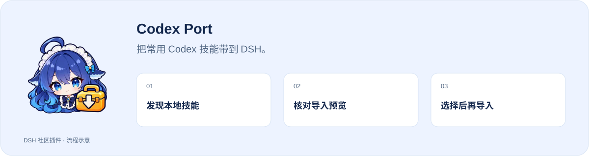

**简体中文** · [English](README.en.md)

# Codex Port

> **安全预览并一键将常用 Codex 技能移植到 DeepSeek Harness。**

DeepSeek Harness（`>=0.2.2-rc.3`）Codex 技能移植插件：离线发现本机技能、先预览目标路径与同名冲突再按需导入，完整保留调用策略与许可说明，并原生适配 Windows 路径。

[](https://www.npmjs.com/package/dsh-codex-port) [](https://www.npmjs.com/package/dsh-codex-port) [](https://www.npmjs.com/package/dsh-codex-port)

**[核心能力](#核心能力) · [安装](#安装) · [快速上手](#开始使用) · [完整说明](https://github.com/STARDUSTLC666/dsh-codex-port/blob/master/docs/REFERENCE.zh.md)**

<picture>
  <source media="(prefers-color-scheme: dark) and (max-width: 640px)" srcset="https://raw.githubusercontent.com/STARDUSTLC666/dsh-codex-port/master/docs/assets/intro/workflow-zh-mobile-dark.svg">
  <source media="(max-width: 640px)" srcset="https://raw.githubusercontent.com/STARDUSTLC666/dsh-codex-port/master/docs/assets/intro/workflow-zh-mobile-light.svg">
  <source media="(prefers-color-scheme: dark)" srcset="https://raw.githubusercontent.com/STARDUSTLC666/dsh-codex-port/master/docs/assets/intro/workflow-zh-dark.svg">
  
</picture>

## 核心能力

| 能力 | 说明 |
| :--- | :--- |
| **本地发现与盘点** | 扫描本机 Codex 技能清单，列出各自依赖与许可说明，不擅自复制 |
| **导入预览与冲突检查** | 写入前先核对目标目录与同名冲突处理方案，原技能目录保持不变 |
| **策略与许可保留** | 迁移时完整保留原调用策略与许可文件，适配 Windows 路径与 Cordis 热重载清理 |

## 安装

在 DSH 桌面版「插件」面板安装 `dsh-codex-port`，或使用命令行：

```bash
dsh plugin --profile desktop add dsh-codex-port
```

网页版将 `desktop` 改为 `web`，安装后重启 DSH。宿主要求：`>=0.2.2-rc.3`。

## 开始使用

1. **指定来源目录**：在目标 DSH 工作区开启会话，告知本地 Codex 技能位置。
2. **先列出清单与许可**：让助手先列出可移植技能、外部依赖与许可说明，不直接整批复制。
3. **预览冲突再导入**：选中需要的技能，核对目标目录与同名冲突后再确认导入。
4. **调用验证**：在 DSH 中实际触发一个已导入技能核对效果，原 Codex 目录不受影响。

### 常用对话示例

> 先列出本机可移植的技能，预览目标目录和重名冲突，暂不导入。

## 开始前要知道

- 技能自身所需的语言运行时与第三方依赖仍需在本机单独准备。
- 详细配置、工具与排错见 [完整说明](https://github.com/STARDUSTLC666/dsh-codex-port/blob/master/docs/REFERENCE.zh.md)。

## 插件更新

在原生插件详情页底部检查更新。默认自动检查，**默认不自动安装**；Suite 管理的组件随整包更新。

## 文档与反馈

- [完整使用、配置与边界](https://github.com/STARDUSTLC666/dsh-codex-port/blob/master/docs/REFERENCE.zh.md) · [更新记录](https://github.com/STARDUSTLC666/dsh-codex-port/blob/master/CHANGELOG.md) · [验证历史](https://github.com/STARDUSTLC666/dsh-codex-port/blob/master/docs/VALIDATION.md)
- 欢迎 Star、提交 [Issues](https://github.com/STARDUSTLC666/dsh-codex-port/issues) 与 [PR](https://github.com/STARDUSTLC666/dsh-codex-port/pulls)（反馈请附版本与复现步骤，并移除凭据）。

## License

[MIT](https://github.com/STARDUSTLC666/dsh-codex-port/blob/master/LICENSE)

<a id="依赖与配置"></a>
